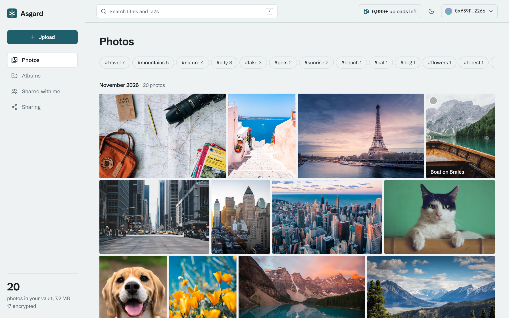
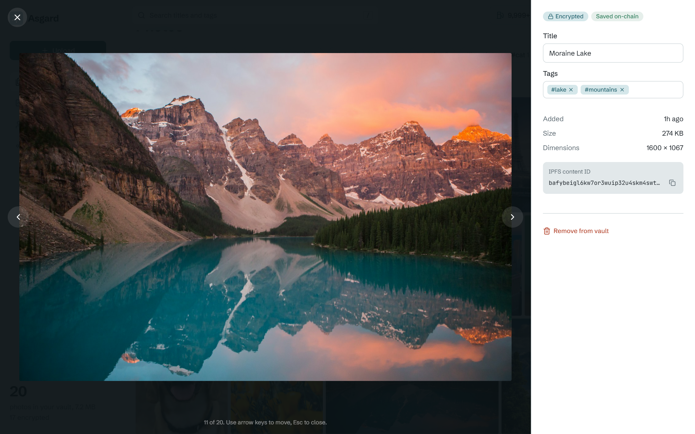
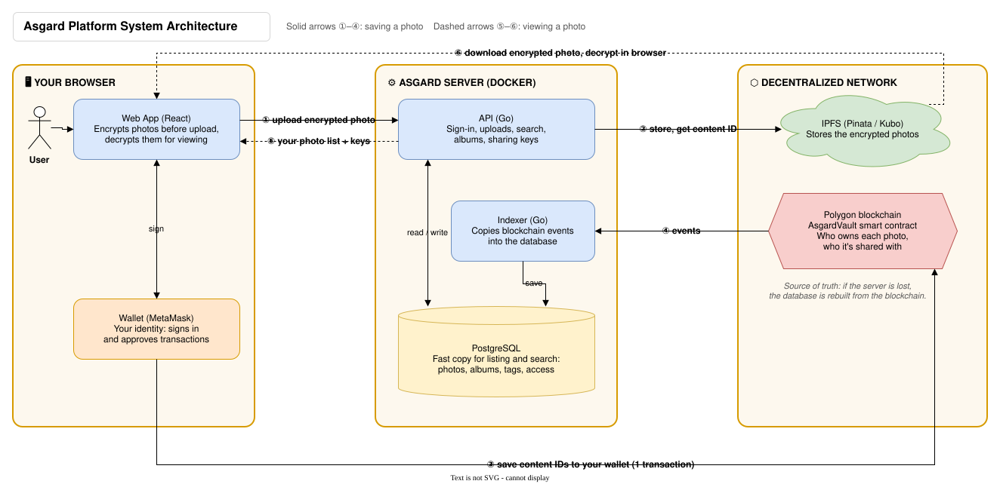

# 🏰 Asgard - Decentralized Image Storage Platform

**🔥 A realm of True Ownership**

## Overview
Asgard is an end-to-end encrypted image vault. Images are encrypted in the browser, stored on IPFS, and registered to the owner's wallet on Polygon; only wallets the owner grants on-chain can decrypt them. A Go backend indexes contract events into Postgres so the gallery, albums and search stay fast, and the whole stack (chain, IPFS, database, API, indexer, web) runs locally with a single `docker compose up`.

## Screenshots
<p align="center">
  
  
  
</p>

## Key Benefits
- True Ownership: files are registered to your wallet address on-chain; no Asgard account or password exists.
- Private by Default: AES-256-GCM encryption happens in your browser; IPFS nodes, gateways and the API only ever see ciphertext.
- Revocable Sharing: grant or revoke a wallet on-chain; file keys are re-wrapped per viewer (X25519) and deleted on revoke.
- Cheap at Scale: CIDs are packed into 32 bytes on-chain and uploads are batched, cutting gas per file by 56% vs v1 (~$0.001 per upload on Polygon).
- Fast: an event indexer mirrors the chain into Postgres, so lists and search answer in tens of milliseconds instead of RPC round-trips.

## Technology Stack

- **Frontend:** React 19, TypeScript, Vite 6, Tailwind CSS 4, wagmi 2 + viem 2, TanStack Query 5, Web Workers + WebCrypto, @noble/curves (X25519)
- **Backend:** Go 1.23 (chi, pgx, go-ethereum), PostgreSQL 16 (tsvector, pg_trgm, GIN), Sign-In with Ethereum (EIP-4361) + JWT
- **Blockchain:** Solidity 0.8.24, OpenZeppelin 5, Hardhat 2 (TypeScript, viem), Polygon Amoy / Anvil (local)
- **Infrastructure:** IPFS (Kubo locally, Pinata hosted), nginx, Docker Compose, pnpm workspaces monorepo
- **Tooling:** Playwright (screenshots), Lighthouse, custom TypeScript benchmark suite (`bench/`)

## Features

- Encrypted Upload: multi-file drag & drop, per-file progress, AES-256-GCM in a Web Worker, thumbnails generated client-side
- Batched On-Chain Registration: up to 50 files in one `addFiles` transaction
- Smart Access Control: grant / revoke viewers on-chain; encrypted keys shared and removed automatically
- Albums, Tags & Search: full-text and fuzzy title search, tag filters, multi-select add-to-album
- Shared With Me: browse vaults other wallets have shared with you (read-only)
- Gas Indicator: live balance, cost per upload, and "≈ uploads left" from the current gas price
- Sign-In with Ethereum: one free signature, no passwords; dev wallets for zero-setup local demos
- Professional UI: dark/light themes, masonry gallery, lightbox, skeleton loading, mobile layout

**System Flow:** Select images → Encrypt in browser → Stream to API → Pin to IPFS (CID) → One signed `addFiles` transaction → Indexer mirrors the event to Postgres → Gallery fetches ciphertext by CID → Decrypt in browser

## 📊 Performance Metrics

All values are measured by scripts in this repo on 2026-11-24 — full methodology and raw numbers in [docs/metrics.md](docs/metrics.md).

| Metric | Value | Baseline |
|--------|-------|----------|
| **Gas per upload (batched)** | 51,477 gas — **−56%** | 118,065 gas (v1 contract) |
| **Cost per upload** | **$0.0011** (~919 uploads per $1) | $0.0025 (v1), Polygon PoS mainnet pricing |
| **End-to-end upload latency** | p50 **342 ms** / p95 570 ms | encrypt → pin → tx → indexed, local stack |
| **API latency at 100k files** | list p95 **51 ms**, search p95 101 ms | 32 concurrent clients, ~575–780 req/s |
| **Search with GIN indexes** | **95–179× faster** on selective queries | sequential scan, 100k rows |
| **Lighthouse performance** | **99** (LCP 0.8 s, CLS ≈ 0) | desktop, production build |

## System Architecture



Source: [docs/architecture.drawio](docs/architecture.drawio) — edit in draw.io, then `pnpm diagram` to regenerate the SVG.

## 🚀 Quickstart

Requires Docker and (for the scripts) Node 20+ with pnpm (`corepack enable`).

```sh
docker compose up --build -d     # chain, IPFS, Postgres, API, indexer, web — no keys needed
# then visit http://localhost:3000 → Open vault → Connect wallet → "Dev #1"
```

Optional:

```sh
pnpm install
pnpm seed      # demo vault: 24 photos, albums, two-way sharing
pnpm e2e       # end-to-end test: auth, encrypt, upload, index, search, grant, revoke
pnpm test      # contract tests (Hardhat)
pnpm bench     # re-measure every metric and regenerate docs/metrics.md
```

To run against Polygon Amoy + Pinata, deploy with `pnpm --filter @asgard/contracts deploy:amoy`, fill `.env` from `.env.example`, then `docker compose -f docker-compose.yml -f compose.amoy.yml up --build`.

**Repository layout:** `apps/web` (React) · `apps/api` (Go API + indexer) · `packages/contracts` (Solidity) · `packages/shared` (ABI, types, crypto) · `bench` (e2e, seed, benchmarks) · `docs`

## 📚 Learn More About Web3

New to Web3? Master the technologies behind Asgard with these official resources:

**Core Technologies:** [Ethereum Official Docs](https://ethereum.org/en/developers/docs/) • [Polygon Documentation](https://docs.polygon.technology/) • [IPFS Protocol Docs](https://docs.ipfs.tech/) • [Pinata IPFS Gateway](https://docs.pinata.cloud/)

**Development Framework:** [Solidity Language Docs](https://docs.soliditylang.org/) • [Hardhat Development Environment](https://hardhat.org/hardhat-runner/docs/getting-started) • [viem](https://viem.sh/) • [wagmi](https://wagmi.sh/) • [Sign-In with Ethereum (EIP-4361)](https://eips.ethereum.org/EIPS/eip-4361)

**Foundational Reading:** [Bitcoin Whitepaper](https://bitcoin.org/bitcoin.pdf) • [Ethereum Whitepaper](https://ethereum.org/en/whitepaper/) • [IPFS Whitepaper](https://github.com/ipfs/papers/raw/master/ipfs-cap2pfs/ipfs-p2p-file-system.pdf) • [Polygon Architecture](https://docs.polygon.technology/docs/develop/ethereum-polygon/getting-started/)
